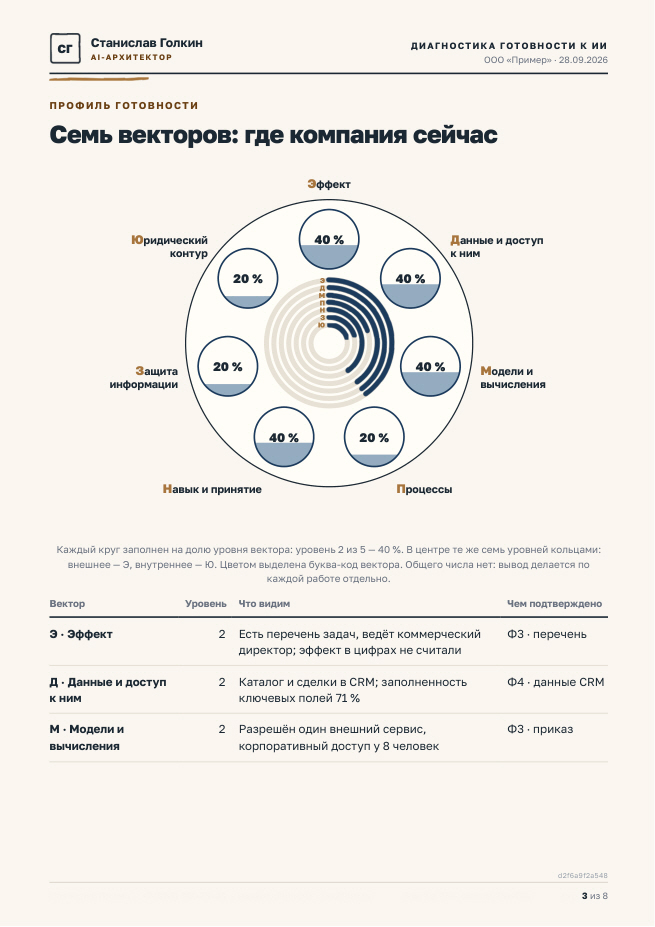

# AuditLLM VECTORS — AI transformation readiness assessment methodology

**Edition:** 2.0 · **Date:** 28.09.2026
**Author:** Stanislav Golkin
**License:** [CC BY 4.0](LICENSE) — English translation of README.md

---

## 1. Purpose of the methodology

**What it does.** Based on verifiable company data, the methodology answers four questions:
1. **What AI work is already possible in the company, and what must not be handed to AI yet** — which concrete tasks, under which conditions, and how to avoid tripping over them.
2. **What specifically gets in the way** — which conditions are not met and what needs to be done first.
3. **In what order to act** — a route through stages, with conditions for moving to the next stage.
4. **What to choose and what to ask for** — implementation options available at the company's readiness level, and the questions to ask vendors — calculating effects and risks with program support.

**Who it is for.** A B2B company that has decided on AI adoption; a consultant conducting the assessment. The methodology is calibrated for 30–1000 employees, primarily B2B. For larger enterprises it can be applied to a separate legal entity or division, or to 1000+ employees.

**Why "VECTORS".** Readiness for AI adoption is driven by seven independent directions — vectors. Each vector moves independently, and each shows in its own way where AI can be handed over — its own set of required vectors. AuditLLM VECTORS is the name of the methodology, not an abbreviation.

**What the methodology does not do.** It does not replace legal review or due diligence: legal risk signs are flagged, not resolved. It does not pick specific vendors: it produces classes of solutions, not brands. The way of obtaining AI and the computing platform also depend on the legal framework (section 20). It does not guarantee results: it produces a verified scenario.

---

## 2. Key concepts

| Concept | Meaning in the methodology |
|---|---|
| **Scenario** | A specific piece of work proposed for AI execution: action + object. Named as "answer the pricing request", "sort inbound requests". The scenario is the primary unit of the methodology |
| **Vector** | One of the seven directions of company readiness (section 4). Each vector has its own internal class scale |
| **Level** | The company's position on the vector's scale from 0 to 5 (section 5) |
| **Sign** | An observed state that is scored as a level. A sign is formulated so that it can be demonstrated |
| **Confirmation** | What confirms the sign: observation, document, log (section 6) |
| **Profile readiness** | The level of the company across all seven vectors together with "not assessed" marks. One company = one profile |
| **Admission conditions** | Four organizational conditions without which scenarios cannot start at any readiness level (section 7) |
| **Scenario status** | The result of matching scenario requirements to admission conditions (section 9) |
| **Danger signal** | A detected practice requiring immediate action regardless of the plan (section 10) |
| **Node** | A vector that blocks the start of scenarios: the largest share of the user portfolio (section 11) |
| **Diagnosis** | A card across the whole portfolio: what can be launched, what is being delayed, whether there are signals (section 12) |
| **Route** | Step-by-step sequence of stages with entry and exit conditions, consistent with the diagnosis (section 13) |
| **Class of solution** | Type, not vendor: "data preparation", "user training", "pilot", etc. (section 14) |
| **Capability** | Scenarios that can start at the current readiness level (section 15) |
| **Option** | A specific way to implement one or several capabilities; subject to selection (section 15) |
| **Effect** | Calculated and post-verified result of an implementation option in hours and money (section 16) |
| **Risk variant** | A possible adverse event, with measures and triggers for response (section 17) |
| **Publicity** | The value of a recognized sign for the client as the company's readiness to move forward (section 17.4) |

---

## 3. Principles

**P1. Output is work, not a document.** The phrase "the company is 3 out of 5 ready for AI" does not help make decisions. The phrase "prepare the answer to the pricing request within a month after connecting the catalog" helps only after legal review.

**P2. Look only at what the work needs.** Scenario blocks are built from the vectors it requires. A weak legal link of the system does not interfere with a scenario on data; a weak link in data does not interfere with a scenario that does not use them.

**P3. Level is scored by confirmed signs.** Each sign is confirmed by evidence, and for high levels — by documents, a log, or two months of stable operation. Regulations that are not complied with do not count as signs.

**P4. "Not assessed" is not the same as "no".** Non-completion does not launch the scenario, but it does produce an information request for evidence.

**P5. Diagnosis does not depend on the contractor's will.** The methodology produces classes of solutions, not a specific document to present, and does not introduce itself.

**P6. One and the same result.** The rules for calculating statuses, nodes, and diagnoses are the same for the consultant and for the two-month audit by the client's internal team.

**P7. Language.** Each vector and level is described in the business language of the industry (what is checked). The report is written in plain language.

---

## 4. Seven readiness vectors

Vectors are chosen so that **each has its own accountable function**. The vector code is a stable identifier used in all tables, profiles and reports (in the Russian edition it is the first letter of the Russian name). For example, protection and information security, legal, and property rights are different vectors: first information security, second legal, third property.

| Code | Vector | Guiding question | Who answers |
|---|---|---|---|
| **E** | Effect | What value does AI bring, and why is it worth it? | CFO, finance director |
| **D** | Data and access | Can the machine read what the company knows? | Data owners, accounting systems, IT |
| **M** | Models and computing | How and on what does the company get AI? | IT |
| **P** | Processes | Is AI part of the process and the executor's routine? | Process owners |
| **S** | Skills | Can people work with AI and hand it over? | HR leaders, division heads |
| **Z** | Protection and information security | What would leak with AI, and who controls it? | Information security |
| **L** | Legal framework | Will transferring data to AI violate the law or contracts? | Legal, responsible record-keepers |

Full vector descriptions — section 5.

---

## 5. Level scale and vector descriptions

### 5.1. Common 0–5 scale

One scale for all vectors. The lower part of the scale is deliberately fine-grained: most companies are only just thinking about AI and sit at levels 0–2, and the differences between them determine the route.

| Level | Name | General meaning |
|---|---|---|
| **0** | Absent | There is no capability, and it is not even being discussed |
| **1** | Ad hoc | There are individual enthusiasts; the company has not allocated the capability and often does not even know about it |
| **2** | Recognized | The company recognizes the topic: rules, lists and responsible people are defined. It does not work in practice |
| **3** | Proven | The capability works in one place, and this is confirmed |
| **4** | Replicable | The capability works in several places, and there is a repeatable way to spread it anew |
| **5** | Measurable | The capability can be measured, re-assessed across the scope, and improves the measured result |

**Level credit rule.** Level N is credited if all mandatory signs of level N and of all lower levels are met, with confirmation strength not below the required one (section 6). If the signs of level N are only partially met, N − 1 is credited, and the protocol records "on the way to N: k of m signs completed".

**Vector "not assessed"** — if there is not a single verified sign of the first level for it, no level is set in the profile.

**"Not verified above"** — if, among the signs of the next credited level, more than half have the status "not verified" (or the level hits a data-collection limit, 18.1), the level gets this mark. For assessment that requires a level higher than the credited one, the vector is treated as assessed.

### 5.2. E — Effect

*For management:* we know why we solve the task with AI, and we can show the result in numbers.

| Lvl | Mandatory signs | How to verify |
|---|---|---|
| 0 | No single goal or task related to AI; no one in the company knows why AI is needed; the question "What task should the company solve with AI?" has no answer | First-line question: "What task should the company solve with AI?" — no answer |
| 1 | Individual leaders take on AI "acceleration" or "cost savings", but no task is set; the result does not change | Answers exist, but they are different and without numbers |
| 2 | A list of work tasks with the expected useful effect is compiled, with a named responsible person who keeps this list | Show the list and name who keeps it |
| 3 | At least one pilot with recorded results: its significance, target value and method of measurement; the result is obtained operationally | Show the figures "was / became" and the conclusions drawn |
| 4 | Scenarios are selected by an approved rule for everyone (user, readiness, risk); AI costs are accounted as a separate line | Show the selection rule and the cost accounting with the records log |
| 5 | Results are working scenarios that are re-scored across the scope; scenarios without a result are closed by decision; the AI effect is included in the planned indicators by department | Show the protocol of the last re-scoring |

### 5.3. D — Data and access

*For management:* what the company knows, where the machine can read it, and whether it can be trusted.

| Lvl | Mandatory signs | How to verify |
|---|---|---|
| 0 | No data needed for work tasks; it is kept orally, re-typed and on paper; there are no learning systems | Ask where the data for a specific task is; answer — "with Ivanova" |
| 1 | Data exists in systems (accounts, accounting system, files), but is not fully filled in; AI receives it only manually | No record substitution; "everything is entered manually" |
| 2 | For work tasks it is known where the data lies, and it can be extracted by key fields; AI can be given a query | Show the completeness measurement and the data extraction |
| 3 | For ongoing scenarios data arrives automatically, from system sources, with a known and frequent update; AI indicates in the answer from which source it took it | Show how the source appears in the answer |
| 4 | Several scenarios use common data access; reading is controlled by rights; every record is visible in the log and changes | Show the log of AI records and the role instructions |
| 5 | Data quality is controlled at the level of the primary set: completeness, freshness, share of the correct source; found errors are corrected in the source | Show the last measurement and the correction in the source |

### 5.4. M — Models and computing

*For management:* which AI the company uses, under what conditions, and how much it costs.

| Lvl | Mandatory signs | How to verify |
|---|---|---|
| 0 | AI services are not used in work | Ask several employees of different roles |
| 1 | Employees use their own personal and free AI services; the company has no list of these services and no allocation | Nobody can name which services are used |
| 2 | The company has approved a list of permitted services and granted access only to them; unofficial access is not recorded | Show the list of permitted services and accounts |
| 3 | For working scenarios the model is chosen by comparison on tasks (quality, speed, cost); access goes through account records | Show the comparison result |
| 4 | All required model classes go through a single access point: visible allocation across departments, a maintained log; the model can be replaced without re-transferring scenarios; for own models — a separate platform (model in-house or two-level control) | Show the allocation and the log; ask what happens when the model is replaced |
| 5 | Model quality is checked against the control set; cost planning is built on actual load | Show the control set and the result of the last check |

### 5.5. P — Processes

*For management:* where AI enters the work process — inside it or beside it.

| Lvl | Mandatory signs | How to verify |
|---|---|---|
| 0 | AI does not participate in any work process | Walk through two or three core processes |
| 1 | AI is used outside processes: a person solves, asks, and separately remembers the result | Observe a working session: copy-pasting between windows |
| 2 | For individual operations a description is written of how to use AI (instructions, example prompt); the result is re-entered by hand | Show the instruction and ask for a prompt, use it and watch |
| 3 | In a defined process AI is a defined step: the launch is triggered by a system event or a mandatory operation, the result lands in the system, a person checks and confirms | Show the launch trigger setting and the acceptance record |
| 4 | AI is a step in several processes; for each such step there are launch guarantees: what AI does by itself, what only after human confirmation; there are work-order settings and a return to manual work | Show the guarantees record and the acceptance procedure |
| 5 | Show a step with AI and measure it with valid results, corrected people, time spent; the boundaries of self-sufficiency expand or narrow by decision | Show the measurement and the decision on boundaries |

### 5.6. S — Skills and techniques

*For management:* do people know how to work with AI and are ready to pass it on.

| Lvl | Mandatory signs | How to verify |
|---|---|---|
| 0 | Employees do not use AI and do not offer what they can do with it; managers do not require it | Talk to two or three employees of different roles |
| 1 | Separate enthusiasts use it; the rest do not know or are afraid; management has no position | Split decision: "use secretly", "afraid", "do not know" |
| 2 | Management has declared a position: what is approved, for what, what is not allowed; training has been conducted for a group | Show the declared position and the list of those trained |
| 3 | Users act on scenarios received in training and can name them; a person is assigned to whom they turn with questions; feedback is collected from users | Show the training materials and the feedback link |
| 4 | There is a repeatable training program for new scenarios and new employees; in each department there are active employees — experts with a confirmed usage level | Show the program and the list of expert testers |
| 5 | Scenarios and techniques are used and measured; mandatory retraining when the process changes; ongoing exchange between employees across departments | Show the measurement and the decision on changes |

### 5.7. Z — Protection and information security

*For management:* what would leak with AI, and who controls it.

| Lvl | Mandatory signs | How to verify |
|---|---|---|
| 0 | There is no rule for transferring any company data to AI services; nobody knows what would be transferred | Question to the head of security or IT |
| 1 | There are general recommendations without prohibitions; there is no control | Show the policy on AI in non-sensitive areas |
| 2 | An approved document on working with AI: what cannot be transferred, which services can be used; employees are familiarized with the provisions | Show the document and the list of those familiarized |
| 3 | For working scenarios a technical control is configured — which data can be transferred (selection or masking), and a log of AI transfers is kept | Show the control setting and the log |
| 4 | AI is admitted only after a check that it complies with the policy, on behalf of the department; lawful AI actions are recorded and agreed; stability checks against changes of scenarios and models | Show the control setting and the check result |
| 5 | Logs are reviewed on a regular basis; incidents with AI that have occurred are investigated and decisions are made on them; protection checks repeat at every change of scenario or model | Show the log review and the last incident or drill |

### 5.8. L — Legal framework

*For management:* we do not violate the law or contracts when transferring data to AI.

The signs of the vector are established with the participation of a lawyer. The methodology specifies what must be assessed, but does not give a legal opinion.

| Lvl | Mandatory signs | How to verify |
|---|---|---|
| 0 | Unknown whether work tasks involve personal data and other protected information; the lawyer is unaware of the topic | Legal question |
| 1 | It is generally known what information exists in the company; no AI assessment is applied to it | The lawyer names the categories, but makes no AI conclusions |
| 2 | For work tasks the categories of involved data are defined (personal data, commercial secret, legally protected access, industry requirements) and the requirements that follow from them; it is established to whom the company is bound by contract | Show the list of categories and work tasks |
| 3 | For working scenarios the requirements that follow from their data are followed: place of processing, storage period, contract with the provider (confidentiality terms, audit right); when transferring abroad — the legally established procedure | Show the data processing documents |
| 4 | Legal assessment is a mandatory stage of launching each new scenario; types of terms of bilateral contracts with AI providers are approved | Show the launch procedure with the legal stage |
| 5 | Changes in legislation and contracts with AI and data change as prescribed; their impact on working scenarios is assessed and records are updated | Show the last such assessment |

---

## 6. Strength of confirmation

| Code | Confirmation | Example |
|---|---|---|
| **C4** | Observation: the consultant saw the work or its trace in the system (log, export, record) | Export from the accounting system with a timestamp |
| **C3** | Document: approved regulation, order, contract, report | Order on permitted services |
| **C2** | Statements of two or more people of different roles, matching in essence | The manager and the employee of one process describe the same procedure |
| **C1** | Statement of a single person | The director's answer on an anecdote |
| **C0** | Consultant's assumption | "Judging by everything, the data exists" |

**Requirements for strength:**
- level 0 may be set on C1 (absence of a valid confirmation is confirmed)
- levels 1–2 — not below C2 for each mandatory sign
- levels 3–5 — each mandatory sign not below C3, and at least one — C4
- an assumption (C0) is not credited at any level; it generates a request for information

**Document without practice.** If a recognized document is confirmed by documents, but observation shows that the document is not executed, it is recognized as unfulfilled for levels 3–5 and as fulfilled for level 2. A written rule is a sign that the topic is understood, not that it works.

**Consequence for the express mode.** When collecting only through a questionnaire and interviews (section 18), there is nothing to confirm a level above 2 with. The product in this mode is honestly limited to level 2, and is not claimed from words.

---

## 7. Scenario admission conditions

Four conditions are checked for each scenario separately. An unmet condition stops the scenario at any readiness level: work without it must not start and must not be operated.

| Code | Condition | What confirms it |
|---|---|---|
| **A1** | The scenario has an explained business goal — a manager who is responsible for the result of the work into which AI comes (not the IT department) | Name and position of the responsible person, confirmed by that manager personally |
| **A2** | It is recorded by which indicators and to what value the scenario will be recognized as successful | Record of the indicators and the evaluation procedure |
| **A3** | The term and limits of operation are limited and agreed by a manager who has the right to set these limits | Written consent to these limits |
| **A4** | A person authorized to stop the scenario is named, and the shutdown procedure is known | Name and understanding of the procedure |

To transfer a scenario from pilot operation to permanent operation, an **acceptance protocol** is needed: the indicator per A2 has changed and the decision to accept it has been made.

---

## 8. Scenarios and their requirements

### 8.1. Scenario card

| Field | Content |
|---|---|
| Name | Action + object: "prepare the response to the pricing request" |
| Process | In which process it occurs |
| Owner | Who is responsible for the result (A1) |
| Users | Roles and number of people who will work with the scenario |
| Load | How many times the work is performed per peak hour |
| Data | Where it is taken from; sensitivity categories (8.3) |
| AI action type | A / B / C / D (8.2) |
| Prohibited AI | What AI must not do under any conditions |
| Benefit | Indicator, value, target value; benefit score 1–3 (11.1) |
| Admission conditions | A1–A4 status |
| Stage | Candidate / pilot / permanent operation / closed |

The fields "Users", "Load", "Data" are used to select the method of obtaining AI and the computing power, which are performed within the methodology.

### 8.2. AI action types

| Type | Name | What AI does | Who checks and how |
|---|---|---|---|
| **A** | Reference | Answers familiar questions | The person decides how to use the answer |
| **B** | Draft | Produces a document, letter, calculation | The person checks and sends |
| **C** | Triage | Splits the incoming flow (requests, calls, letters), distributes, highlights the main thing, writes into the system | The person looks and acts |
| **D** | Action | Performs the operation in the system itself: creates or changes a record, sends | AI within recorded boundaries |

### 8.3. Data categories

| Cat. | What it includes |
|---|---|
| **1** | Open and publicly available information: common materials, own texts without restrictions |
| **2** | Internal information without a legal regime: internal regulations, catalogs, depersonalized statistics |
| **3** | Protected information: personal data, commercial secret, legally protected access, data with partner requirements |

If a scenario involves data of different categories, the scenario is assigned the highest.

### 8.4. Requirements table

Minimum vector levels. First — for pilot operation, second — for permanent operation. A dash means the vector is not required by this scenario.

**By action type:**

| Vector | A · Reference | B · Draft | C · Triage | D · Action |
|---|---|---|---|---|
| E | 2 / 3 | 2 / 3 | 2 / 3 | 2 / 3 |
| D | 2 / 3 | 2 / 3 | 2 / 3 | 3 / 4 |
| M | 2 / 3 | 2 / 3 | 2 / 3 | 2 / 3 |
| P | 1 / 2 | 2 / 3 | 2 / 3 | 3 / 4 |
| S | 2 / 3 | 2 / 3 | 2 / 3 | 2 / 3 |

**By data category** (added to the requirements by type):

| Vector | Cat. 1 | Cat. 2 | Cat. 3 |
|---|---|---|---|
| Z | 2 / 2 | 2 / 3 | 3 / 4 |
| L | — | 2 / 2 | 3 / 3 |
| M | — | — | 2 / 4 |

**Correction for D:** the Z requirement for permanent operation is not lower than 4 for any data category — AI that acts by itself must have recorded and agreed legal actions.

**Mandatory.** If the transfer of model data without the safeguards contained in them does not remain in place, the scenario for vectors M and Z is counted at level 2, and for vector L — at level 3: the legal self-sufficiency of the same level is assessed.

For category 3, the L requirement is mandatory for both pilot and permanent operation: pilot operation on current data must be lawful.

The overall requirement for a scenario by vector is the maximum of the applicable ones.

---

## 9. Scenario status

Status is calculated by the strictest rule in order:

| Order | Condition | Status | What this means for management |
|---|---|---|---|
| 1 | A required vector is "not assessed" | **Not assessed** | There is not enough evidence; an evidence request is attached to the status |
| 2 | An admission condition is not met | **Needs refinement** | Vector readiness is sufficient: first the owner, metrics, money, legal setup |
| 3 | Category 3 data and the L requirement is not met | **Legal barrier** | Launching is impossible without a legal assessment and its execution — even at level 2 vectors |
| 4 | All vector requirements are met | **Ready to start** | Pilot operation can begin |
| 5 | Technical underfill (9.1) to be closed by no more than 2 levels and not more than 2 vectors | **Ready after conditions** | The list of unmet conditions — the first stage of the route |
| 6 | Everything else | **Postpone** | The scenario requires preparation, regardless of current readiness |

**Underfill by vector** — the difference between the required and the actual level, if the actual is lower; the total underfill is the vector sum.

### 9.1. Organizational and technical underfill

An underfill on vectors E, S, Z, L at levels 0–2 is organizational: it is closed by a management decision, a document, training and a legal assessment within a few weeks. The rest of the underfill is technical: it requires work with data, systems, models and processes.

At level 5 only the technical underfill remains. The organizational underfill is deferred, but **all admission conditions** move to the first stage of the route.

*Justification.* Without these closures, almost every scenario of a typical company — where there is no document on working with AI and no legal assessment — would get the status "Postpone", although it could actually start within a few weeks.

For pilot operation the same order applies: verification for permanent operation follows the vector tables 8.4.

---

## 10. Danger signals

A signal is not a forecast but an already detected practice that creates an immediate risk. Signals are reported first, regardless of the diagnosis.

| Code | Signal | When it triggers |
|---|---|---|
| **DS-1** | Protected information goes to external services without a legal assessment | There is a confirmed (not below C2) fact of transferring category 3 data to external services, and Z ≤ 1 or L ≤ 1 |
| **DS-2** | Automatic actions in systems without safeguards | A type D or C scenario operates autonomously and the procedure for stopping it is not recorded (P below 4 or Z below 4) |
| **DS-3** | A working scenario on data without a legal assessment | A scenario with category 3 data operates, and L = 3 |

---

## 11. Benefit, priority and node

### 11.1. Scenario scoring

| Score | Meaning |
|---|---|
| **3** | Noticeably changes revenue, margin and costs; a significant competitive advantage |
| **2** | Noticeable time savings for a group of employees or acceleration of work |
| **1** | Satisfies the needs of individual people; the effect is labor-intensive to measure |

The score is set by the indicator record; without a record, the score is not given.

### 11.2. Scenario order

Scenarios are ordered as follows:
1. by status: "Ready to start" → "Ready after conditions" → "Needs refinement" → "Legal barrier" → "Postpone" → "Not assessed";
2. within a status — by benefit, from higher to lower;
3. with equal benefit — by the vector underfill sum, from smaller to larger.

Meaning of the rule: start where the benefit meets the readiness, not where the gap is largest. The first scenario must give a measurable result quickly — it builds trust for the next ones.

### 11.3. Node

For each vector, the user benefit is counted: the sum of benefit scores of scenarios with the status "Ready to start" or "Postpone" for which this vector is insufficient.

**Node** — a vector whose user benefit falls short of 60% of the total benefit of all delayed scenarios. There may be several node vectors — then they are listed in order of decreasing benefit; with equal benefit — in the order L, Z, E, S, D, P, M: first the mandatory and fast ones, then the long ones.

---

## 12. Diagnosis

The diagnosis is determined by the strictest rule in order; the first applicable rule gives the diagnosis. Danger signals (section 10) are reported first, regardless of the diagnosis.

| Order | Condition | Diagnosis | Route |
|---|---|---|---|
| 1 | More than half of the scenarios have the status "Not assessed" or vector E is "not assessed" | **D-0. Card incomplete** | R-0 |
| 2 | The portfolio contains at least one scenario with benefit 2 or higher, and E ≤ 1 | **D-1. Undefined why** | R-1 |
| 3 | For all scenarios with benefit 2 and above the status is "Needs refinement" | **D-2. No conditions** | R-2 |
| 4 | Two or more scenarios in permanent operation, and there are statuses "Ready to start" | **D-3. Time to scale** | R-3 |
| 5 | There are scenarios with the status "Ready to start" | **D-4. Ready for the first launch** | R-4 |
| 6 | There is a node (11.3) | **D-5. Node** (with a list of node vectors) | R-5 with node checks, in order |
| 7 | Everything else | **D-6. Scattered underfills** | R-6 |

The order rule guarantees that any portfolio gets a single, unambiguous diagnosis. The main diagnosis is supplemented with: a list of scenarios by statuses, nodes (if any, even under another main diagnosis) and danger signals.

---

## 13. Routes

Each route is stages with entry and exit conditions. Timelines are approximate for a company of 50–300 employees; they are refined by the results of the first stage. Route class codes — section 14.

### R-0. Card incomplete → gather evidence

| Stage | What is done | Output |
|---|---|---|
| 1 | Requests for each "not assessed" vector and scenario: which documents to show, with whom to speak, what to upload | List of evidence requests received |
| 2 | Collect and verify the assessment | No more than two vectors remain "not assessed" |

Term: 1–3 weeks. **Do not:** issue recommendations for permanent operation at stage 2.

### R-1. Undefined why → find work tasks where AI accumulates

| Stage | What is done | Classes | Output |
|---|---|---|---|
| 1 | Analyze processes and bottlenecks: where the time of valuable groups goes, where there are delays and client losses | K1 | 10–20 work-task candidates |
| 2 | Scenario cards with the "should" indicator and benefit score | K1 | A scenario with benefit 2+ |
| 3 | Recalculate statuses and diagnosis | — | New diagnosis |

Term: 2–4 weeks. **Do not:** buy services and equipment "to try".

### R-2. No conditions → obtain decisions

| Stage | What is done | Classes | Output |
|---|---|---|---|
| 1 | Meeting with the first manager: two or three scenarios with the highest benefit, what needs to be launched, how much it costs, what the risk is if not done | K1 | Decision on the indicators for launch |
| 2 | Appointment of owners, record of indicators, agreement of terms and cost limits, appointment of legal setup | K1 | A1–A4 completed for the scenario |

Term: 1–2 weeks. **Do not:** start pilot preparation of data and technical setup — such work should not be done in pilot operation.

### R-3. Time to scale → make new scenarios repeatable

| Stage | What is done | Classes | Output |
|---|---|---|---|
| 1 | A single rule for selecting scenarios and accounting the AI effect | K1 | E = 4 |
| 2 | Single access to models with allocation accounting and a journal | K4, K7 | M = 4 |
| 3 | Common data access and distribution of rights | K3, K5, K7, K8 | D = 4, Z = 4 |
| 4 | Training program for new scenarios; responsible persons in departments | K2 | S = 4 |
| 5 | Launch the next scenario in order of benefit 11.2 | by scenario | New scenarios in pilot operation |

Term: 3–6 months. **Do not:** launch all scenarios at once — a wave no larger than the technical service.

### R-4. Ready for the first launch → trust-building work

| Stage | What is done | Classes | Output |
|---|---|---|---|
| 1 | Collect 2–4 variants (section 15); the manager chooses; for the chosen one — effects and risks (sections 16–17); pilot plan with risk signs and stop conditions | K1 | Selected variant, approved pilot plan |
| 2 | Fulfill admission conditions and pre-launch safeguards; prepare to obtain AI from the variants | K4, K3 | The scenario works on real tasks |
| 3 | Pilot operation: measure the indicator, collect errors, feedback | K2 | The indicator change is shown |
| 4 | Acceptance: decision to move to permanent operation, extend or close | K1 | Acceptance protocol |
| 5 | Bring the vectors up to permanent-operation levels | by node | The scenario is in permanent operation |

Term: 1.5–4 months for the first scenario. **Do not:** launch a parallel second scenario before the first one is accepted.

### R-5. Node → remove the node

Common order: **choose one scenario with the highest benefit among the delayed ones with a node vector, not "raise all vectors at once".** Removing the node gives a result that the manager sees and creates the basis for the rest.

| Node | What is done | Classes | Typical term |
|---|---|---|---|
| **E** | Record of the "should" indicator, legal assessment of the benefit, cost accounting | K1 | 2–4 weeks |
| **D** | Measure completeness, fix the sources, automatic data collection into the scenario | K3, K5 | 1–3 months |
| **M** | List of permitted services, corporate access, comparison of models on tasks; the way of obtaining AI — with account records | K4 | 2–8 weeks; longer if a self-hosted compute platform is required |
| **P** | Embed AI as a step in the process: event-triggered launch, result entry through an intermediary, record of guarantees | K5, K8, K1 | 1–2 months |
| **S** | Position and training of users, a person for questions | K2, K1 | 2–6 weeks |
| **Z** | Document on working with AI, transfer bans, journal, separation of rights | K7, K8, K1 | 3–8 weeks |
| **L** | Legal: data categories, requirements, contracts with providers, notifications, legally prescribed | K6 | 3–8 weeks |

After removing the node — recalculate statuses and diagnosis.

### R-6. Scattered underfills → a one-off project on a single scenario

| Stage | What is done | Classes | Output |
|---|---|---|---|
| 1 | Choose one scenario with the highest benefit and the smallest total underfill | K1 | A scenario chosen for the project |
| 2 | Close the underfills of all vectors of this scenario under one manager | by node | Status "Ready to start" |
| 3 | Then — as in R-4 | — | The scenario is in permanent operation |

Term: 2–5 months. **Do not:** run a "confirm all vectors to 3" program — it is long and gives no result.

### Cross-cutting rule for all routes

**Danger signals are closed first.** If the report contains a signal, the first stage of any route is: DS-1 → K7 + K6 + K1 (a rule and a legal assessment of information transfer); DS-2 → a record of guarantees and the shutdown procedure, and if that is impossible — stop the scenario; DS-3 → a legal assessment, and if it confirms the risk — stop the scenario.

---

### 13.8. Roadmap

The route answers **in what order**; the roadmap — **when**. It leads to a single time scale (not calendar dates) in three layers:
1. these route stages are fed by the smallest significant readiness;
2. planned variants: admission conditions, pilot operation, acceptance, permanent operation (17.6), stages of implementing the chosen way of obtaining AI;
3. then: scenarios that open after the chosen variant (16.4), and final scenarios with conditions, at which point the work moves into the routine.

For each roadmap point: what is done, who is responsible on the company side (who — on the consultant's side), the result, the indicator by which this stage is counted as passed, the exact decision point — where the manager decides whether to continue or not, and obligatorily — before any large purchase. The terms of the first indication give a range and help understand how soon the client will receive the first acceptance.

## 14. Classes of solutions

### 14.1. List

| Code | Class | When needed |
|---|---|---|
| **K1** | Organizational decisions: management decisions, owners, rules, indicators | Always; the first measure of any route |
| **K2** | Training and support of users | S below the required level |
| **K3** | Data preparation: measurement, correction of sources, setup of data exchange | D below the required level |
| **K4** | Way of obtaining AI: choosing from where and under what conditions the model is obtained (14.2) | Every implementation variant; M below the required level |
| **K5** | Integration with systems: event-triggered launch, result recording, links between systems | P and D below the required level for types B and C |
| **K6** | Legal measures: assessment, contracts, notifications and other actions prescribed by law | L below the required level |
| **K7** | Technical protection measures: restriction of transferred information, journals, separation of rights, checks on deployment | Z below the required level |
| **K8** | Embedding: AI becomes part of the system, an access program with a closed list of operations; a program that checks each request against a closed list of rules which it executes in the system itself | Any direct AI actions in the system; readable information about changes, deletions, transfers and records |
| **K9** | Not to implement | Benefit 1 with insufficient readiness; stop signs of risk, reasonable measures |

### 14.2. Way of obtaining AI

Class K4 means what the scenario chooses as the way of obtaining AI. The methodology sets **what must hold** when choosing:
- data categories of the scenario (8.3) and vector L requirements;
- load and users from the scenario card (8.1);
- presence of a deployed AI function in the systems the company uses;
- level of vector M and the requirements for it (8.4).

The list of ways is legally valid, not exhaustive, and does not depend on the method of calculating computing power in the methodology (section 20): they depend on the offered market and change faster than the methodology. Different ways for the same scenario give different variants (15.3).

**K9 — full refusal, not a diagnostic.** Refusing a scenario with a recorded reason creates a reasoned recommendation.

---

## 15. Capabilities and implementation variants

### 15.1. Capabilities

**Capability** — scenarios that the company can start at the current readiness level: with the status "Ready to start" or "Ready after conditions". Capabilities are shown to the manager in the order of priority 11.2. Scenarios with the statuses "Postpone" and "Legal barrier" are shown separately as the next step: with the conditions under which the work becomes available.

### 15.2. Variant

**Variant** — a concrete way to implement one capability (or two or three linked ones with common data and users). A variant is what the manager chooses. Variant card:

| Field | Content |
|---|---|
| Scenarios | Which capabilities it implements |
| Way of obtaining AI | The selected method (K4, 14.2); how exactly — is described separately from the methodology |
| Scope | Who and how many users participate; at which stage of the process |
| AI boundaries | What AI does by itself, what — after confirmation, what is prohibited |
| Legal AI in systems | Which systems it touches: which scenarios are necessary, which will be made upon access (legal records and access), goes through K8 |
| Admission conditions | Unmet requirements — organizational and technical (9.1) |
| Term | Until the initial pilot operation and until permanent operation |
| Costs | One-time and monthly, by supplier categories and internal |
| Effect | Calculation per section 16 |
| Risks | Calculation per section 17 |
| What opens up | Which vectors become available and which scenarios become available (16.4) |

### 15.3. Rules for choosing variants

1. The manager is offered **from two to four variants**. One variant is not a choice; five or more are hard to compare.
2. All variants must be **named the same way**: the same path to a measurable result, the same legal feasibility, the same group of users and the same simplest way of obtaining AI.
3. If different ways of obtaining AI (14.2) are possible, their difference is shown numerically, not directly.
4. A variant may include scenarios with the statuses "Postpone", "Legal barrier", "Needs refinement" or "Not assessed".
5. Among the variants, all show "nothing to do": what the company loses (losses by the indicator card) and which danger signals remain.
6. Variants are compared in a single table: benefit, term, costs, effect (expected and source), highest risk, what it controls. The consultant's final recommendation is stated separately, with reasons.

After the choice, the manager executes the chosen variant **in full effect and risks** (sections 16–17), and the variant becomes the plan of the first stage of the route.

---

## 16. Effect of the chosen variant

### 16.1. Composition of the effect

| Type | How it is calculated | Example |
|---|---|---|
| **Time** | Savings per operation × number of operations per month × cost of an hour of the performer | Preparing the KP: 3 h → 1 h, 120 KPs per month |
| **Money directly** | Change in revenue or margin by the indicator card: conversions, average check, share of repeat purchases | An answer to the request immediately instead of two days → growing repeat requests |
| **Losses** | Reduction of losses on penalties, fines, returns, downtime | Penalties and fines on overdue obligations |
| **For the following scenarios** | The set benefit of the variant that becomes available after its implementation (16.4) | Connecting the catalog needs one more scenario |

The economic effect is calculated in money only if the scenario name says what will be directed to the result in time. Otherwise the indicator is shown in hours, and money — only if it does not distort the result.

### 16.2. Three meanings

Each effect is calculated in three meanings:
- **expected** — by the values of the indicator card;
- **cautious** — with a risk discount: the effect still holds when the previously unrealizable or transferred indicator is not fulfilled. If the cautious measure is not taken, the full effect is taken;
- **confirmed** — appears only after measurement on pilot operation (condition A2 and the acceptance protocol). Until measured, any effect in the report is marked as **calculated**.

### 16.3. Purchase cost

Costs are divided into one-time (data preparation, integration, setup, training, legal measures) and monthly (access to models or platform, support). The purchase cost is calculated in two ways — by supplier categories and internal. If the supplier's effect variant is not purchased within the term acceptable to the manager, this is stated directly.

### 16.4. Effect for the following scenarios

The variant opens vectors: connected data, configured access to models, a work document with AI, trained people — and with them the underfill of the needed vector disappears and the status changes to "Ready to start" or "Ready after conditions". The sum of the opened benefits — the **"opening user benefit"** of the variant. The variant with the highest opening among those close in effect is preferred: that is the one that opens more for the user.

---

## 17. Risks of the chosen variant

### 17.1. Where risks come from

Risks are derived from three sources, not invented:
1. **Underfill by vectors.** Shown by vector where the company is below the requirements of permanent operation (tables 8.4), it creates the risk that the scenario will not survive the transfer to permanent operation.
2. **AI action type** — indicates its characteristic error (17.2).
3. **Data categories** — the more sensitive the information, the more serious the consequences of an error and the legal risks.

4. **Legal AI in systems** (pilot variant). The risk is calculated by what AI **may** do with the visible rights, not by what it does. If the scenario only needs to read a base, and the visible access allows it to issue an order, sign a contract, change or delete records — the risk is rated T-I. Each legal right issued above what is needed creates a separate T-I risk.

The consultant may add a risk that is not in these sources, recorded as such.

### 17.2. Risk list

| Code | Risk | Source |
|---|---|---|
| **T-E** | Effect not confirmed: the indicator does not move or moves unmeasurably | Underfill by E |
| **T-D** | AI answers wrongly or incompletely because of the data | Underfill by D |
| **T-M** | Model quality is insufficient for the tasks; costs grow faster than the effect; the supplier changes terms or is unavailable | Underfill by M; model of an external supplier |
| **T-P** | The AI step fails or double-writes the result; errors in AI pass without a check | Underfill by P |
| **T-S** | Users do not use the scenario, or misuse it, recheck the result | Underfill by S |
| **T-Z** | Leak of information, execution of prohibited inputs, excess rights | Underfill by Z; categories 2–3 |
| **T-L** | Violation of requirements for data or contracts with providers | Underfill by L; categories 2–3 |
| **T-A** | A confident but wrong answer, acted upon | Type A |
| **T-B** | Wrong figures or conditions in a draft that goes to the client | Type B |
| **T-C** | Misclassification or a missed important item, wrong routing | Type C |
| **T-G** | AI acts in systems or performs an action outside the permissions | Type G |
| **T-I** | Excessive legal right: AI may read, change, delete or transfer more than needed | Legal AI in systems: issued above what is needed |
| **T-O** | The supplier's business interest changes, breaks the supply or uses the data | All data; reinforced if the hosting is outside the jurisdiction of acceptance |

### 17.3. Assessment

Each risk variant is assessed by **probability** and **severity** on a 1–3 scale; the risk score is their product (1–9).

**Probability** for risks from underfill: no underfill → 1; underfill of 1 level → 2; 2 levels or the vector "not assessed" → 3. For the T-O risk type, the probability is estimated by the consultant's record.

**Severity:**
- 3 — type G and legal data 3; for T-Z and T-L — any category 3;
- 2 — types B and C with severity 2, as well as any risk whose consequences the contractor includes in the company;
- 1 — the rest.

**Risk T-I is assessed by the highest of the two rules:**
- probability: direct access → 3; through an intermediary K8 that allows such an operation not to be missed → 1;
- severity: deletion or change of accounting records, money, contracts → 3; creation of records or readable information above what is needed → 2; reading within what is needed → 1.

The consultant may change the calculated assessment only with a recorded reason, in the report.

### 17.4. Measures, signs and stop conditions

For each risk with an assessment of 4 and above:
- **preventive measure** — the class of solution performed before launch, reducing severity by one step;
- **early sign** — what to notice to catch the risk before it happens (deadlines, share of unfulfilled, write-off of the client, records in the journal);
- **stop threshold** — the value of the sign at which the scenario's operation stops per A4;
- **responsible** — named.

**Rule of the stop order.** If the scenario needs legal creation, change, deletion or transfer outside, the warning measures before launch are silenced by K8: AI transfers the request through an intermediary, which checks it and performs it in the system. In the latter case, without AI — it acts only by recorded rules (which operations, under which conditions, with which fields, how many times) and keeps a journal. Refusal of the latter access is allowed only with a recorded reason, and then the T-I severity is 3.

### 17.5. Summary by variant

| Total | Condition |
|---|---|
| **Allowed** | No risk above 4 |
| **Allowed with measures** | There is a risk 6–9, but after the measures no risk above 4 remains |
| **Not allowed to enter** | At least one risk 6–9 remains after all measures |

A variant "not allowed to enter" does not block: the manager is shown what needs to change (essentially — a different way of obtaining AI, the initial price of the route), and a crossing variant.

### 17.6. Effects and risks of the measure

The measure decision is made on one table, where risks sit next to the expected and source effect, costs, purchase cost, the highest risk with measures, stop conditions and the result per 17.5. The order of introducing the risks moves to the plan of pilot operation (route R-4, stage 1).

---

## 18. Order of the consultant's work

### 18.1. Two collection modes

| Mode | How evidence is collected | What can be confirmed |
|---|---|---|
| **Express** | First-line questionnaire + 1–2 interviews | Product up to level 2 inclusive; levels above — "not verified above". Scenario statuses above 2 — "Not assessed". The report notes that it is preliminary |
| **Full** | Questionnaire, interviews with process owners, IT, security and legal; documents; exports; observation of the work | The whole profile 0–5 |

### 18.2. Steps

| Step | What is done | Result |
|---|---|---|
| 1 | Collect evidence in the chosen mode; each collected fact is marked with its confirmation strength | Registry of facts |
| 2 | Compose the portfolio: 5–15 work-task candidates, scenario cards | Portfolio |
| 3 | Assess the signs by seven vectors: for each sign — state and confirmation | Profile readiness |
| 4 | Check the admission conditions A1–A4 for each scenario | A1–A4 assessments |
| 5 | Calculate statuses, nodes, signals and diagnosis by the rules of sections 9–12 | Calculated part |
| 6 | Choose the route and classes of solutions; describe the first stage in words | Route |
| 7 | Form variants with comparison tables (section 15) | Variants |
| 8 | Report structure and breakdown | Chosen variant |
| 9 | Full calculation of the effects and risks of the chosen variant (sections 16–17); pilot operation plan | Recommendation to start |
| 10 | Repeat the diagnosis after 3–6 months: comparison of the profile, statuses, diagnosis and confirmed effect with the calculation | Dynamics |

Steps 3 and 5 are deliberately separated: at step 3 the consultant works with facts, at step 5 — only with rules. The result can also be rechecked this way.

---

## 19. Report structure

1. **Final single page:** diagnosis in the manager's words, danger signals, three first actions, what not to do.
2. **Danger signals** — if any, separately before everything.
3. **Portfolio of scenarios:** a table with statuses, benefit and node with unmet conditions for each.
4. **Profile readiness:** seven vectors, level, "on the way to N" marks, "not assessed" marks. Illustrated by a filled radar chart: each vector from 0 to 100% (level 2 of 5 — 40%); a not-assessed vector — an empty circle. Overall readiness.
5. **Route and roadmap:** stages, terms, classes of solutions, what is done at each; the roadmap card per 13.8 with the manager's decision points.
6. **Capabilities and variants:** a comparison table of variants side by side with "nothing to do"; the consultant's recommendation with reasons.
7. **For the chosen variant** (a separate document after the choice): effects in three meanings, costs and purchase cost, risk register with measures, early signs and stop conditions, pilot operation plan, and the result per 17.5. The calculation of the way of obtaining AI and computing power, if needed, does not go into the methodology — separately.
8. **What not to do:** sources of information, strength of confirmation, requests for the unverified. A separate line — the collection mode (express or full).
9. **Legal applicability:** legal signs with a confirmed status.

---

## 20. Boundaries of application and update

- The methodology does not assess companies that produce AI as their main product; for them there is another scale.
- **Way of obtaining AI** — an external service without transferring data outside, a self-hosted and a rented computing platform — its choice, placement and cost calculation are made within the legal framework of the methodology. The methodology defines what must be entered in the order, in which case, at what — it decides at the start.
- Descriptions of programs, services and models change their methodology. A reference to competitive solutions is maintained separately from the methodology and is updated on its own.
- Thresholds (legal statuses, the 60% node share, requirements of table 8.4, scales and results of risk scoring, effect thresholds) — part of the methodology. Their change launches a new edition with a date and changes.
- The methodology states which legal issues must be assessed; the answers are given by lawyers.

---

## 21. Foundations

General provisions on which the methodology stands; references to independent sources confirm the existence of such a methodology. The methodology's own solutions are chosen by the principle "own accountability, own class scale 0–5 with a fine lower part, strength of confirmation, admission conditions, output to actions by data categories, legal status, node and diagnosis, catalog of routes and classes of solutions".

| General provision | Source |
|---|---|
| Readiness is assessed by several directions, not one | Microsoft, Agentic AI Adoption Maturity Model, "How to use the agentic AI adoption maturity model", step 1 — learn.microsoft.com/en-us/agents/adoption-maturity-model/maturity-model-how-to-use (accessed 31.03.2026) |
| Assessment is based on facts, not wishes | Same, step 1: assess "by facts, not by wishes" |
| Readiness is scored numerically | Same, step 2: do not reduce the score to a single ball — it hides weak spots |
| Path "experiment → operation → scale" | AWS Prescriptive Guidance, Generative AI Maturity Model: levels "explore — experiment — launch — scale" — docs.aws.amazon.com/prescriptive-guidance/latest/strategy-gen-ai-maturity-model/overview-levels.html |
| System results are organizational | E. Goldratt, theory of constraints; the book "The Goal" (1984) |
| Maturity models with levels | CMMI (Capability Maturity Model Integration), CMMI Institute / ISACA: five maturity levels of processes — cmmiinstitute.com/learning/appraisals/levels |

Sources are open and were checked on 28.09.2026.

RU version: [README.md](README.md)
